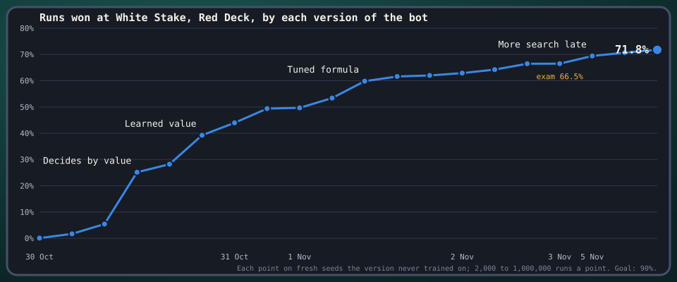
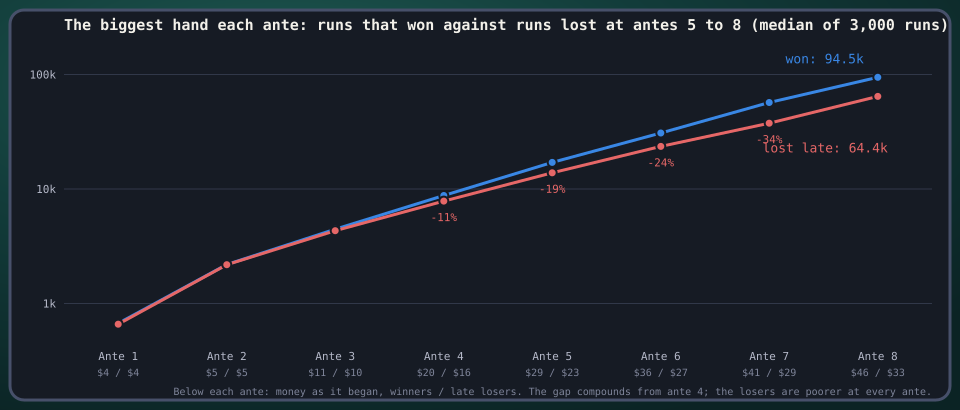

# Balatro Meta

What's the best way to play [Balatro](https://www.playbalatro.com/)? A computer plays it hundreds of thousands
of times on a faithful copy of the game, sees only what a player sees, and learns from its own runs. The goal is
a bot that wins 90% of runs at White Stake and finds strategies its human teacher doesn't know.

> **Unofficial fan project.** Balatro is made by LocalThunk and published by Playstack. This project is not
> affiliated with, endorsed by or connected to either of them, and the repo holds none of the game's code, text,
> art or sound. To play, buy the game.



## Balatro in a paragraph

Balatro is a solitaire card game built on poker hands. A run is eight rounds ("antes"), each with three score
targets ("blinds") that roughly double from one to the next; the third of each ante is a boss blind with a rule
of its own. You hold eight cards, play up to four poker hands and discard up to three times per blind, and each
hand scores chips × mult. The run is won by beating ante 8's boss. Between blinds a shop sells jokers (up to five
held, and the source of nearly all scoring), planet cards that level up a hand type, tarot cards that change your
cards, vouchers and packs; money earns interest. Everything random comes from the run's seed. Stakes are
difficulty levels, White the easiest and Gold the hardest; decks change the starting rules (Red Deck: one more
discard). The bot plays White Stake with the Red Deck, the game's first table, where a strong human wins most runs.

## The idea

1. **A faithful game.** Our own Rust engine plays Balatro 1.0.1o rule for rule: all 150 jokers, 52 consumables,
   32 vouchers, 24 tags and 28 boss blinds. The same seed deals the same cards, shops and packs as the real game,
   checked against the real game move by move.
2. **A fair player.** The bot sees only what the screen shows: never the seed, the draw order or the next shop.
   When it looks ahead it plays on copies whose hidden parts are reshuffled, the way a player imagines what might
   come. Nothing it learns comes from replaying a seed it has already seen.
3. **Deciding by value, learning from play.** Every move, from a purchase to the cards in a hand, is tried on
   copies and judged by one number: the chance of beating the blinds ahead, the run's scoring power later, money as
   buying power, plus a network's estimate of the chance of winning, trained on the bot's own runs.

## What it found

1. **Search at the decisive moments is worth more than a better judge.** Three times the usual samples from
   ante 5 on took the bot from 66.4% to 70.7% on the same 8,000 seeds (p = 2 × 10⁻²⁰); four times the samples in
   boss blinds added another point, to 71.8%; three times the samples at every ante added 3.8 more, to 75.6%
   (p = 4 × 10⁻¹¹), and the exam agreed; six times everywhere added about 2 more on a 2,000-seed screen (p = 0.053).
   The price is a bot about seven times slower per run than before the budget rises, which is why the budget is
   now being made adaptive (more samples only where a decision's best options are close). The gain carried to
   every stake without a rule written for them: half again as many wins at Red, Green and Black.
2. **Its losses are near misses.** Of 1,160 lost runs, 44% scored 80% or more of the target they fell to and
   another 43% between half and 80%; only 13% were hopeless. 82% die at a boss, 70% at antes 5 to 8, and the ante 8
   finisher Violet Vessel (six times the base target) alone takes 12%.
3. **A third of lost blinds were winnable with the cards it had.** Played again from the blind's start with four
   times the samples, the bot beat 36% of the blinds it had lost (49% of the near misses). By boss: Violet Vessel
   10% (a build problem), The Mouth 51% and Amber Acorn 44% (play problems).
4. **The build gap compounds from ante 4.** Runs that go on to lose at antes 5 to 8 trail the winners' biggest hand
   by 11% at ante 4, 19% at 5, 24% at 6 and 34% at 7, and are poorer at every ante ($16 against $20 at ante 4). It
   isn't one bad decision; it is a weaker economy feeding a weaker engine from ante 3 on.

   

5. **The shop choices it weighs are close calls.** 6,750 forked decisions (each of the bot's best options played
   out to the end of the run on shared fair copies) found its choice, its networks and picking at random all within
   a point of win rate of each other; a network trained on those forks played worse. The gains were not in choosing
   between its top options.
6. **Learning from outcomes alone plateaued.** Ten rounds of recording 25,000 runs and training a network on
   how each position's run ended gained 1.75 points at round 4, 0.4 at round 5 and little after round 6, with or
   without exploration. More say for the networks helped up to a point (66.1% at weight 4) and collapsed past it
   (53.8% at weight 16): picking the best of many options with a judge that errs picks its errors.
7. **Skipping blinds for tags is a wash at White Stake.** Made a move judged by value like any other (the skip
   and the blind each played out on fair copies to where the tag has acted), the bot skipped 0.34 blinds a run,
   the ones a player takes (an Investment tag at ante 1, edition jokers, Economy when rich), and came out level:
   76.85% against 77.05% on 2,000 seeds. A blind and its shop are worth about what a tag is, at the stake where
   every blind pays; the harder stakes, where the Small Blind pays nothing, are untested.
8. **A human player's rules mostly hurt as rules.** Of seven lessons from a player who wins three runs in four,
   only "focus on one hand" held up (+1.6 points on 8,000 seeds). Extra points for x mult jokers or a thin deck
   made the bot worse (−1 to −2.5): they skew everything else it weighs.

## Current performance

| Table | Bot | Seeds | Won |
| --- | --- | --- | --- |
| White Stake, Red Deck | champion of 6 November (3× samples everywhere, 4× in boss blinds) | 8,000 exam seeds, kept apart and never used to choose | **75.6%** |
| White Stake, Red Deck | champion of 6 November | 8,000 tuning seeds | 75.6% |
| White Stake, Red Deck | champion of 3 November | the exam seeds | 66.5% |
| Red Stake | champion of 6 November (3 November's in brackets) | 2,000 | 61.4% (52.0%) |
| Green · Black · Blue | champion of 6 November | 2,000 each | 29.0% · 16.1% · 11.4% (19.7 · 11.4 · 8.8) |
| Purple · Orange · Gold | champion of 6 November | 2,000 each | 2.9% · 1.5% · 0.15% (1.9 · 0.9 · 0.2) |

The tuning seeds are where ideas are compared and the winners kept, so they can flatter the bot; the exam seeds
only ever measure the best bot there is, and are the headline. So far the two have agreed: 66.5% on both for the
champion of 3 November, 75.6% on both for the champion of 6 November (the 2,000-seed screen that found it said
77%, which is the flattery). Every measured version, with its code, options and seeds, is in
`results/progress.jsonl`.

## How we know it's right

- The engine is checked against the real game through [BalatroBot](https://github.com/coder/balatrobot): while
  the viewer runs, a hidden copy of the game replays the bot's runs move by move and every number on screen is
  compared with the engine's. A difference stops that run's check and is saved with both states. Since 29 October
  the checks have saved 78 differences; replayed on today's engine (`make recheck`, 7 November), 62 are fixed and
  16 open: 6 hands dealt after a pack, 4 larger scoring gaps, 4 cash-outs a dollar or two apart, 2 rounds the engine
  ends that the game doesn't. Of the fixed, 14 were The Pillar (the "played this ante" mark comes after the hand is
  scored) and 23 were scores one chip apart in the last bits of a double (Obelisk), which the checks now let through
  (up to 3 chips) and carry on. From 5 November the checks keep a tally of the runs and moves they compared
  (`results/checks.json`); before that, no count was kept, so there is no honest "N moves, 0 mismatches" to quote.
- Two versions of the bot are always compared on the same seeds, run by run, with a paired test; a version's own
  win rate on 8,000 seeds is known to about ±1 point.
- Training uses fresh seeds; tests use seeds the bot never played; the exam's seeds choose nothing.
- The fair-play wall is one module (`observe.rs`) and is fuzzed: a fair copy and the real run give the bot the
  same screen.

## How it does it

- **Engine** (`crates/bm-core`, `crates/bm-rng`): the game's random streams bit for bit, scoring, jokers, blinds,
  shop, packs and consumables, each with a note in `rules/` in our own words.
- **The teacher bot** (`teacher.rs`, `value.rs`, `planner.rs`): every decision by the value of the position it
  leads to, measured by playing the coming rounds out on fair copies; a planner that chooses which hand to build in
  each round; a search budget that grows where runs are decided.
- **The learned value** (`learned.rs`, `scripts/train_value.py`): an ensemble of networks that read the screen and
  give the chance of winning, trained by expert iteration on the bot's recordings. Each is a small PyTorch MLP:
  about 4,000 to 4,900 inputs encoding the screen (hand, deck, jokers, shop, money, blind, stake), one or two hidden
  layers of 64 to 128 ReLU units with heavy dropout (0.3, on the inputs too, so it can't learn runs by heart), and
  26 outputs (the win logit and the blind the run ends at, plus 13 for how far a win goes on). A round trains on
  about 7 million positions in a few minutes on the GPU and exports flat weights that the Rust engine evaluates
  itself, so the bot needs no Python at play time.
- **The network that plays** (`scripts/train_policy.py`, `make train`): a 4-layer, 128-wide transformer in PyTorch
  over the screen's objects (cards, jokers, shop items), with heads for the move's kind, slot, target and cards and
  illegal moves masked; trained by imitation of three million of the teacher's moves, then PPO on the vectorised
  engine. It plays a run in milliseconds and won 22.8% of 5,000 seeds when the teacher of its day won 39%; it
  becomes the student again once the teacher has stopped improving.
- **Forks and diagnosis** (`forks.rs`, `baseline --diagnose`): decisions played out to the end on shared fair
  copies, and lost blinds played again with deeper search, to find where the win rate is hiding before tuning.
- **Jobs and results** (`scripts/jobs.py`, `results/`): every measurement reproducible from its report; a viewer
  (`make watch`) that replays the bot's runs and charts the climb.

## Read more

- [The project page](docs/index.html) (GitHub Pages serves it from `main`, folder `/docs`): the climb, one of the
  bot's best runs, how it plays and learns, where it loses, what's next.
- [RUNNING.md](RUNNING.md): every job, in order, with what it found.
- [`rules/`](rules/): the game's rules as the engine plays them, with sources.
- [`results/`](results/): every measured bot.

```
bash bootstrap.sh      # Linux or WSL2 with Rust and Python 3.12: installs and builds everything
make test              # the engine's tests, the fixtures from the game's own random streams, the jobs
make baseline          # the bot on fresh seeds, reporting as it goes
```

---

Balatro Meta is an independent, non-commercial fan project, not affiliated with LocalThunk or Playstack. Our own
code and notes are under the MIT licence ([LICENSE](LICENSE)), which covers nothing of Balatro's. The results are a
strong guide to good play at White Stake, not proof of best play: a bot that wins 72% still loses more than one run
in four.
